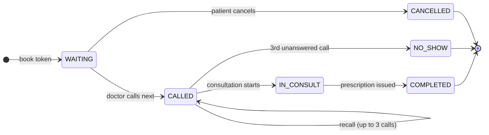
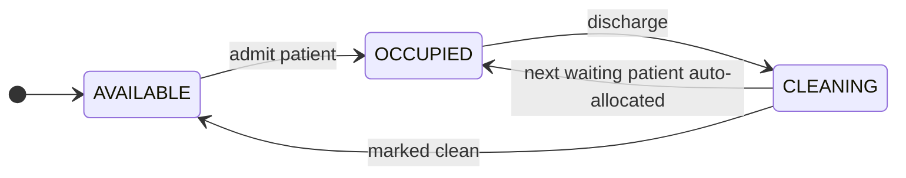
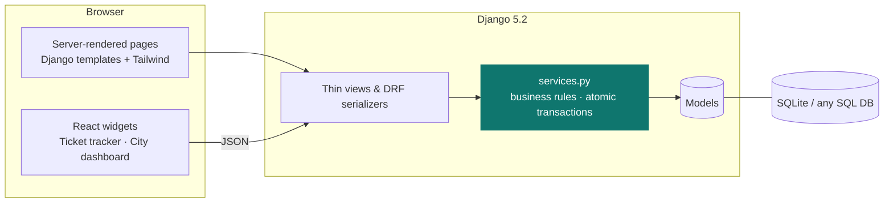
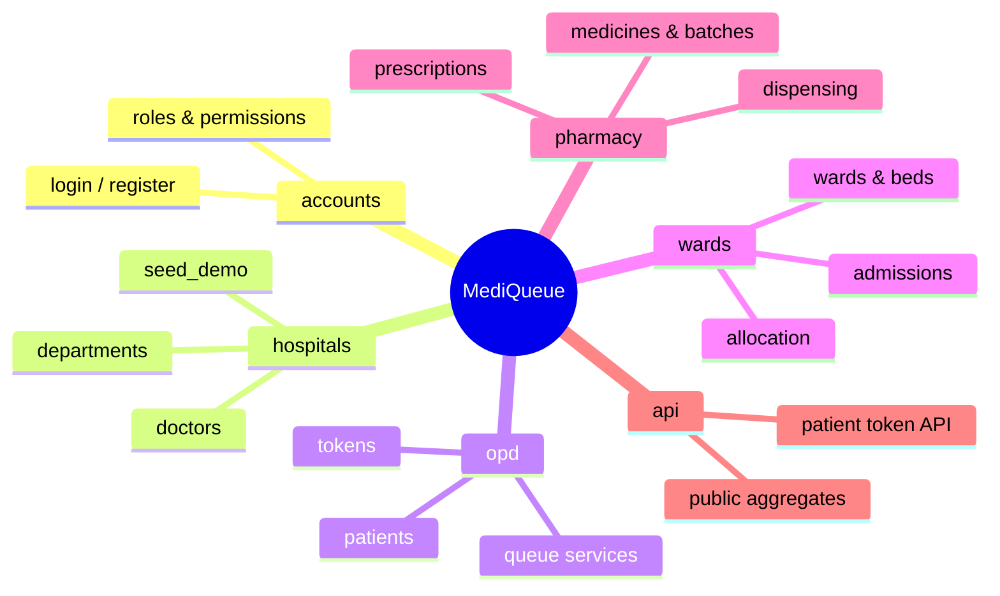
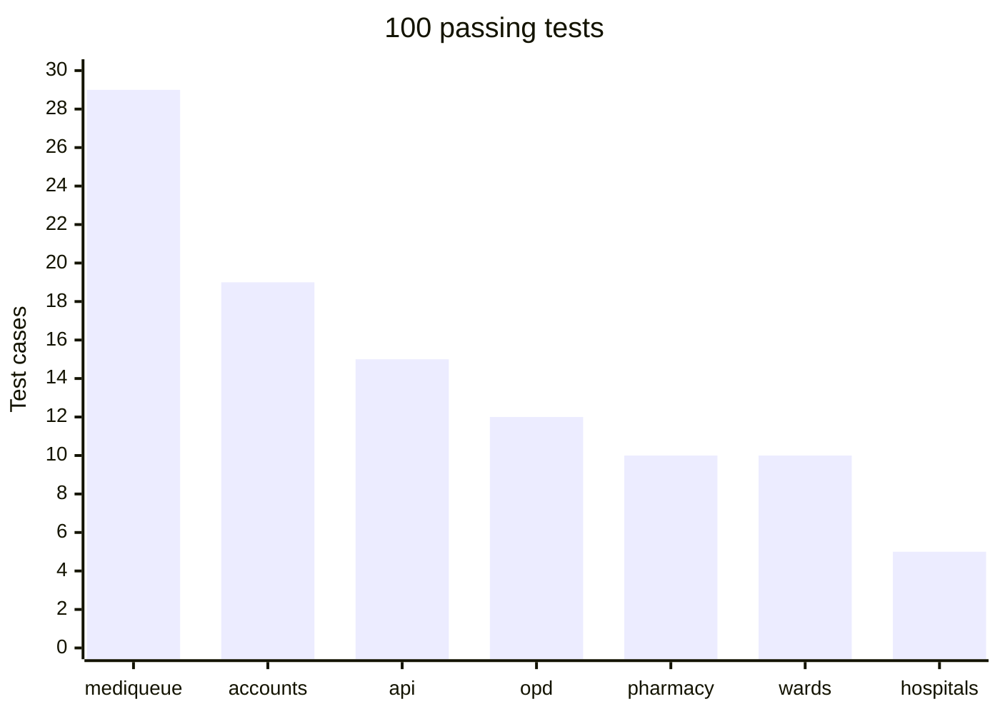

<div align="center">


<a href="https://git.io/typing-svg"></a>

<br/>


</div>

---

## What is MediQueue?

Hospital front desks run on paper slips and shouting. **MediQueue** replaces that with one small system that covers the whole outpatient journey:

- **OPD queue** — patients book a token, see a live estimated wait, and get called by the doctor.
- **Ward beds and admissions** — beds are allocated safely, with a waiting list when the ward is full.
- **Pharmacy** — prescriptions are dispensed all-or-nothing against batch stock with expiry checks.
- **City dashboard** — a public page with aggregate numbers only (queue lengths, free beds, stock flags). No patient data is ever exposed.

Built for the INT253 (Django) CA3 project. Django does the heavy lifting; the patient tracker and the city dashboard are small React widgets on top.

---

## Highlights

| | |
|---|---|
| **Safe concurrency** | Bed allocation uses `transaction.atomic` + `select_for_update`; stock deduction uses guarded `F()` expressions. Two receptionists cannot grab the same bed. |
| **Priority-aware queue** | Priority tokens jump ahead, wait estimates come from each department's average consult time, and a third unanswered call becomes a no-show. |
| **Role-based access** | Patient, Receptionist, Doctor, Pharmacist and Admin each see only their own screens. Patients only ever see their own tokens. |
| **Privacy by design** | The public API returns counts only. |
| **Thin views, fat services** | All business rules live in each app's `services.py` and are unit-tested. |
| **Polished UI** | Boarding-pass style ticket tracker, dark mode, smooth scrolling (Lenis), GSAP motion, cross-page view transitions. |

---

## How a patient token moves



## How a bed moves



---

## Architecture



### Apps



---

## Test coverage by app



```bash
python manage.py test
```

---

## Who does what

| Role | What they do |
|---|---|
| **Patient** | Registers, books an OPD token, follows their place in the queue live, cancels while waiting, sees past visits |
| **Receptionist** | Issues walk-in tokens (including priority), admits patients to wards, manages the bed board and waiting list |
| **Doctor** | Calls the next patient, runs the consultation, writes a prescription, requests admissions |
| **Pharmacist** | Dispenses prescriptions, rejects ones it cannot fill, tracks stock, expiry and reorder alerts |
| **Admin** | Manages hospitals, departments, users, medicines and wards in Django Admin |
| **Anyone** | Sees city-wide totals on the landing page and `/city/` |

## Public API

Aggregates only. Patient endpoints require login and CSRF.

| Method | Endpoint | Access | Returns |
|---|---|---|---|
| GET | `/api/city/hospitals/` | public | Per-hospital waiting count, free beds, stock flags |
| GET | `/api/hospitals/<id>/departments/` | public | Department load and estimated wait |
| GET | `/api/hospitals/<id>/beds/` | public | Bed counts by ward and status |
| POST | `/api/tokens/` | patient | Book a token |
| GET | `/api/tokens/<id>/` | patient (own) | Token status and position |
| POST | `/api/tokens/<id>/cancel/` | patient (own) | Cancel while waiting |

---

## Tech stack

| Layer | Tools |
|---|---|
| Backend | Python, Django 5.2 LTS, Django REST Framework |
| Frontend | Django templates, React 18 (tracker + city widgets), Tailwind CSS v4, Vite |
| Motion | GSAP, Lenis smooth scroll, View Transitions API |
| Serving | Gunicorn, WhiteNoise |
| Database | SQLite for dev and demo (swap the `DATABASES` block for PostgreSQL) |

---

## Run it locally

You need Python 3.12 or newer.

```bash
python -m venv .venv
.venv\Scripts\activate            # macOS/Linux: source .venv/bin/activate
pip install -r requirements.txt
python manage.py migrate
python manage.py seed_demo --activity
python manage.py runserver
```

Open <http://127.0.0.1:8000>. The built frontend is committed in `static/dist/`, so Node is only needed if you change `frontend/`:

```bash
cd frontend && npm install && npm run build
```

### Demo logins

Every password is `demo`.

| Username | Role | Hospital |
|---|---|---|
| `patient` | Patient | — |
| `reception` | Receptionist | City Care |
| `doctor` | Doctor (Cardiology) | City Care |
| `pharmacist` | Pharmacist | City Care |
| `admin` | Admin (also `/admin/`) | City Care |

### A 2-minute demo path

1. Sign in as `patient`, book a Cardiology token and watch the tracker.
2. Sign in as `doctor`, call that token, start the consultation, add medicines and complete it.
3. Sign in as `pharmacist` and dispense the prescription.
4. Sign in as `reception`, admit a patient to a ward and watch the bed board.
5. Open `/city/` signed out to see the public totals.

---

## Deploy

The repo ships with a [`render.yaml`](render.yaml) blueprint: push to GitHub, create a **Blueprint** on [Render](https://render.com), and it builds, migrates and seeds demo data automatically.

| Environment variable | Purpose |
|---|---|
| `DJANGO_DEBUG` | `0` in production |
| `DJANGO_SECRET_KEY` | Long random string (Render generates one) |
| `DJANGO_ALLOWED_HOSTS` | Comma-separated hosts, e.g. `.onrender.com` |
| `DJANGO_CSRF_ORIGINS` | Extra trusted origins for a custom domain (`https://example.com`) |

> The free tier uses an ephemeral disk, so the SQLite data resets on each deploy and is re-seeded. The demo passwords are public: treat any hosted copy as a demo only.

---

## Project layout

```
accounts/    users, roles, login, registration, role decorator
hospitals/   hospitals, departments, doctors, seed_demo command
opd/         patients, tokens, queue services, reception & doctor screens, tracker
wards/       wards, beds, admissions, allocation services
pharmacy/    medicines, prescriptions, stock movements, dispensing services
api/         public aggregate endpoints + patient token API
mediqueue/   settings, landing page, staff overview, shared helpers
frontend/    Vite + Tailwind + React source (builds into static/dist/)
templates/   Django templates
```

<div align="center">


</div>
